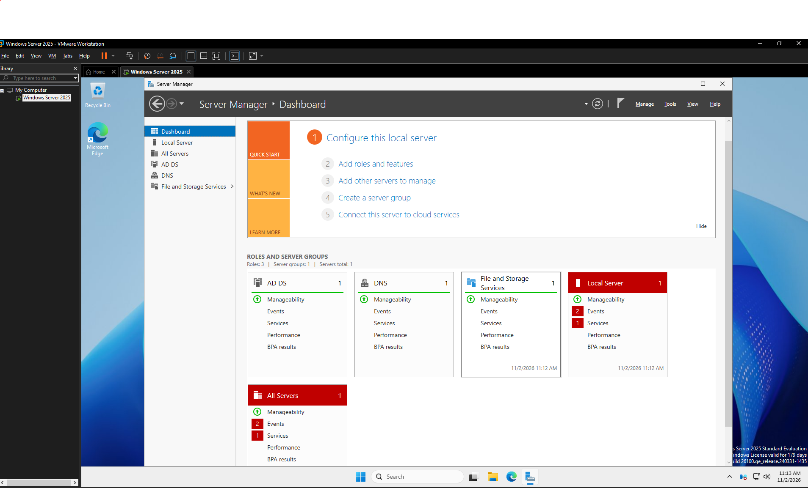

# Phase 1: Windows Server 2025 Installation

**Project:** Active Directory Home Lab  
**Virtualization Software:** VMware Workstation  
**Operating System:** Windows Server 2025  
**Status:** Completed

## 1. Objective

The objective of this phase was to install Windows Server 2025 in a virtual machine using VMware Workstation.

Windows Server provides the foundation for the Active Directory environment. It will be used to manage domain users, security groups, computers, DNS, and shared network resources.

## 2. Environment Setup

The lab environment uses virtualization to simulate a small business network without requiring additional physical computers.

| Component | Configuration |
|---|---|
| Virtualization software | VMware Workstation |
| Server operating system | Windows Server 2025 |
| Server hostname | [Enter hostname] |
| Server role | Domain Controller |
| Client operating system | Windows 11 |

## 3. Installation Process

The server installation involved:

1. Creating a new virtual machine in VMware Workstation.
2. Selecting the Windows Server 2025 installation media.
3. Configuring the virtual machine's hardware resources.
4. Installing Windows Server 2025.
5. Completing the initial Windows configuration.
6. Accessing Server Manager after installation.

## 4. Verification

Windows Server 2025 successfully installed and booted inside VMware Workstation.

Server Manager was accessible, allowing the server roles and administrative tools to be configured.

## 5. Evidence

- `windows-server-2025.png`

## 6. Skills Demonstrated

- Virtual machine creation.
- Windows Server installation.
- Basic server administration.
- VMware Workstation configuration.
- Windows Server management.

## 7. Conclusion

This phase established the Windows Server environment needed to build the Active Directory lab. Using VMware Workstation allowed the server to run in an isolated virtual environment for configuration and testing.
