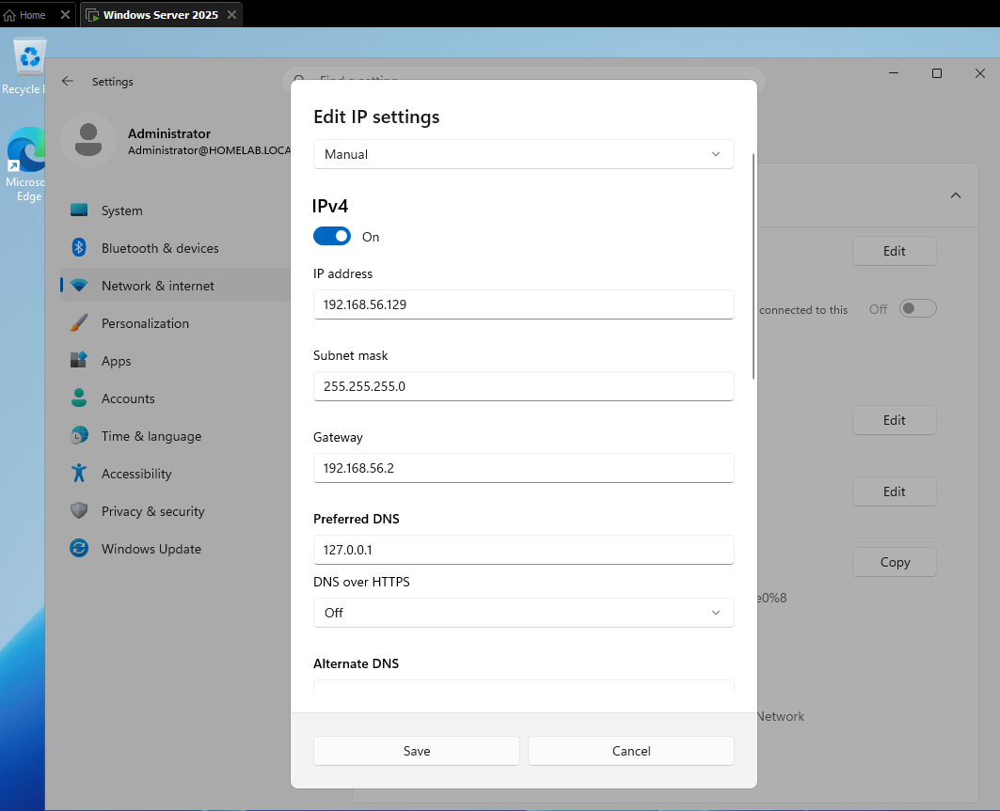

## 2. Network Configuration

The Windows Server 2025 Domain Controller was configured with a manually assigned static IPv4 address to maintain a consistent network identity.

### Server Network Information

| Setting | Configuration |
|---|---|
| Server hostname | FileServer01 (reported) |
| Active Directory domain | HOMELAB.LOCAL |
| IPv4 address | 192.168.56.129 |
| Subnet mask | 255.255.255.0 |
| Default gateway | 192.168.56.2 |
| Preferred DNS | 127.0.0.1 |
| IP assignment | Manual (Static) |

### DNS Configuration

The Domain Controller uses `127.0.0.1` as its preferred DNS address.

This is the loopback address, which directs DNS queries back to the local server. Because the server hosts Active Directory and DNS, it can use its own DNS service to resolve domain records.

The Windows 11 client should use the Domain Controller's actual network IP address, `192.168.56.129`, as its preferred DNS server.

### Network Subnet

The configured subnet mask of `255.255.255.0` identifies the network as:

`192.168.56.0/24`

The server's address is within this subnet.

### Verification

The following commands can be used to verify the network configuration:

```cmd
ipconfig /all
```

```cmd
nslookup HOMELAB.LOCAL
```

```cmd
ping 192.168.56.129
```

### Evidence

- `ip-config-dns-config.PNG`


