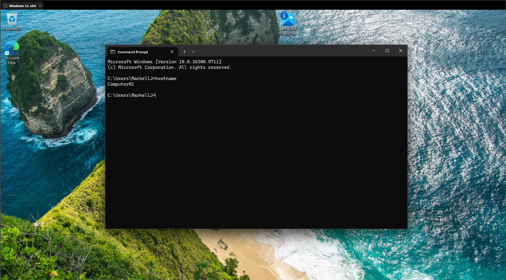
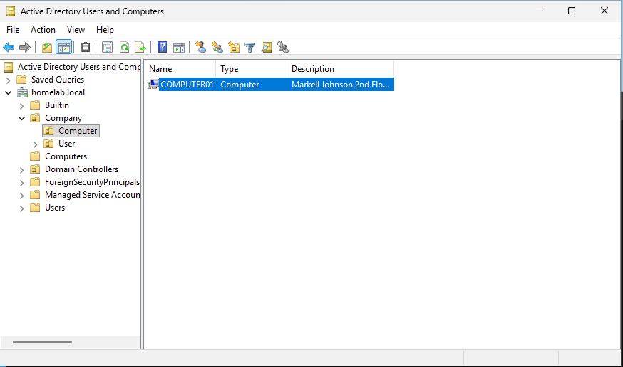

# Phase 5: Windows 11 Client Setup and Domain Joining

**Project:** Active Directory Home Lab  
**Client Operating System:** Windows 11  
**Server Operating System:** Windows Server 2025  
**Status:** Evidence available.

## 1. Objective

The objective of this phase was to create a Windows 11 client virtual machine and connect it to the Active Directory domain.

In a business environment, employee workstations are commonly joined to a domain so administrators can centrally manage accounts and authentication.

## 2. Windows 11 Client Setup

A Windows 11 virtual machine was created using VMware Workstation.

The client machine represents an employee workstation that will communicate with the Windows Server Domain Controller.

The setup involved:

1. Creating a Windows 11 virtual machine.
2. Installing the Windows operating system.
3. Completing the initial Windows configuration.
4. Configuring the virtual network adapter.
5. Preparing the client for domain joining.

**Evidence:** `windows-11-client.png`

## 3. Preparing the Client for Domain Joining

Before joining the domain, the client needs network connectivity to the Domain Controller.

The client must also use the Domain Controller's DNS server so that it can locate Active Directory services.

Windows 11 Pro, Enterprise, or Education is required for traditional Active Directory domain joining. Windows 11 Home does not support this feature.

## 4. Joining the Active Directory Domain

The Windows 11 client was moved into the Active Directory domain.

The process involved:

1. Opening Windows system settings.
2. Accessing the computer's domain or workgroup settings.
3. Selecting the option to join a domain.
4. Entering the Active Directory domain name.
5. Providing authorized domain credentials.
6. Completing the domain-joining process.
7. Restarting the computer.

**Evidence:** `Windows-Client-Moved-To-Active-Directory-Domain.PNG`

## 5. Verification

After joining the domain, verify that:

- Windows reports that the computer is part of the domain.
- The computer appears in Active Directory Users and Computers.
- The client can communicate with the Domain Controller.
- A domain user can sign in successfully.

## 6. Skills Demonstrated

- Windows 11 installation.
- VMware virtual machine management.
- Windows domain joining.
- DNS configuration.
- Domain authentication.
- Client and server connectivity.

## 7. Conclusion

This phase connected the Windows 11 workstation to the Active Directory environment. Domain joining allows the workstation to use centralized authentication and gives administrators the ability to manage domain-connected computers and users.
