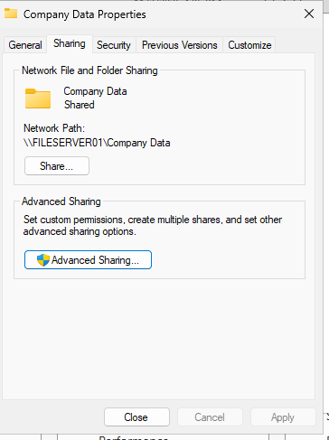
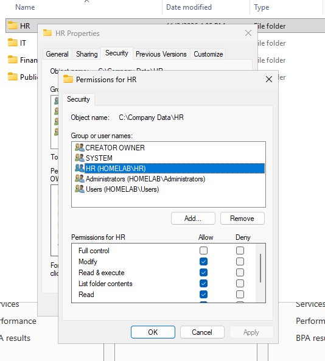
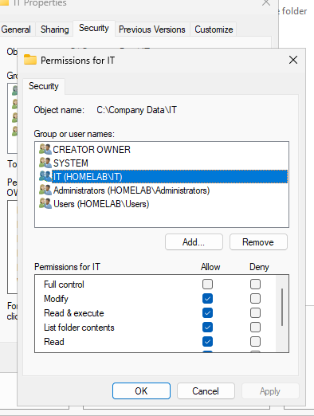
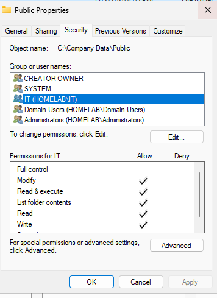
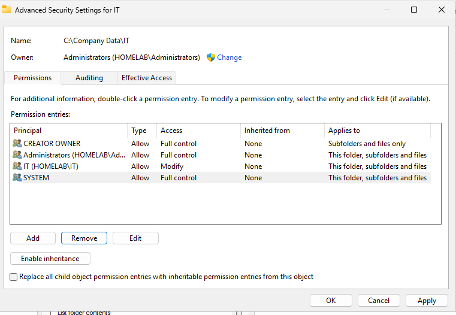

# Phase 6: Shared Folder and NTFS Permissions

**Project:** Active Directory Home Lab  
**Environment:** Windows Server 2025, Active Directory, VMware Workstation  
**Status:** Configuration evidence available; access tests should be verified.

## 1. Objective

The objective of this phase was to configure shared folders on Windows Server and manage access using share permissions, NTFS permissions, and Active Directory security groups.

This setup simulates a business environment where different departments need access to their own files while preventing unauthorized users from accessing restricted information.

The three main shared folder areas are:

- **HR:** Human Resources department files.
- **IT:** Information Technology department files.
- **Public:** Shared resources intended for authorized users.

## 2. Configuring Server Share Permissions

Shared folders were configured on Windows Server 2025 to allow network access from domain-connected computers.

Share permissions control which users and groups can access folders over the network.

The configuration involved:

1. Creating and configuring shared folders.
2. Opening the folder properties.
3. Navigating to the Sharing tab.
4. Configuring network sharing permissions.
5. Reviewing which users and groups have access.

**Evidence:** `Configuring-Server-Share-Permissions.PNG`

## 3. Managing Department NTFS Permissions

NTFS permissions control what users can do with files and folders, including reading, modifying, writing, and deleting files.

Permissions were managed separately for the HR, IT, and Public folders.

### HR Folder

The HR folder is intended for Human Resources employees and authorized administrators.

Permissions were configured to control access to HR department resources.

**Evidence:** `Managing-HR-NFTS-Permissions.PNG`

### IT Folder

The IT folder is intended for Information Technology employees and authorized administrators.

Access was managed separately to help ensure that only approved users and groups can access IT resources.

**Evidence:** `Managing-IT-NFTS-Permissions.PNG`

### Public Folder

The Public folder is intended to provide access to shared resources.

Its permissions were configured separately from the restricted department folders.

**Evidence:** `Managing-Public-NFTS-Permissions.PNG`

## 4. Disabling Permission Inheritance

Windows uses permission inheritance to allow files and folders to receive permissions from their parent folders.

For this configuration, inheritance was disabled on a folder to allow more specific access permissions to be assigned.

The configuration involved:

1. Opening the folder's Security properties.
2. Navigating to Advanced Security Settings.
3. Disabling inheritance.
4. Reviewing inherited permissions.
5. Configuring the intended access permissions.

**Evidence:** `Disable-Inheritance-and-only-allow-access-to-IT.PNG`

## 5. Using Security Groups to Manage Access

Active Directory security groups make it easier to manage permissions for multiple users.

Instead of assigning permissions individually to every employee, users can be placed into department-specific security groups.

Those groups can then be assigned permissions to the appropriate shared folders.

This approach makes it easier to manage access when employees join, leave, or change departments.

## 6. Testing and Verification

After configuring the shared folders and permissions, access should be tested using domain user accounts.

The purpose of testing is to confirm that:

- HR users can access authorized HR resources.
- IT users can access authorized IT resources.
- Public resources are accessible to intended users.
- Users cannot access restricted department folders without authorization.
- Authorized administrators retain the access they need.

| Test | Expected result | Actual result |
|---|---|---|
| HR user accesses HR folder | Access allowed | To be recorded |
| HR user accesses restricted IT folder | Access denied | To be recorded |
| IT user accesses IT folder | Access allowed | To be recorded |
| IT user accesses restricted HR folder | Access denied | To be recorded |
| Authorized user accesses Public folder | Access allowed | To be recorded |

**Important:** Share permissions and NTFS permissions work together when a folder is accessed over the network. The effective access is determined by both sets of permissions.

## 7. Skills Demonstrated

- Windows Server file sharing.
- Network share permissions.
- NTFS file system permissions.
- Active Directory security groups.
- Department-based access control.
- Permission inheritance.
- User access management.
- Basic file server administration.

## 8. Conclusion

This phase demonstrated how shared folders and permissions can be managed in a Windows Server environment.

By separating HR, IT, and Public resources and using security groups, the lab simulates how an organization can manage employee access to shared files.

These skills are useful in IT support and system administration because technicians frequently troubleshoot file access issues, manage user permissions, and help maintain secure network resources.
