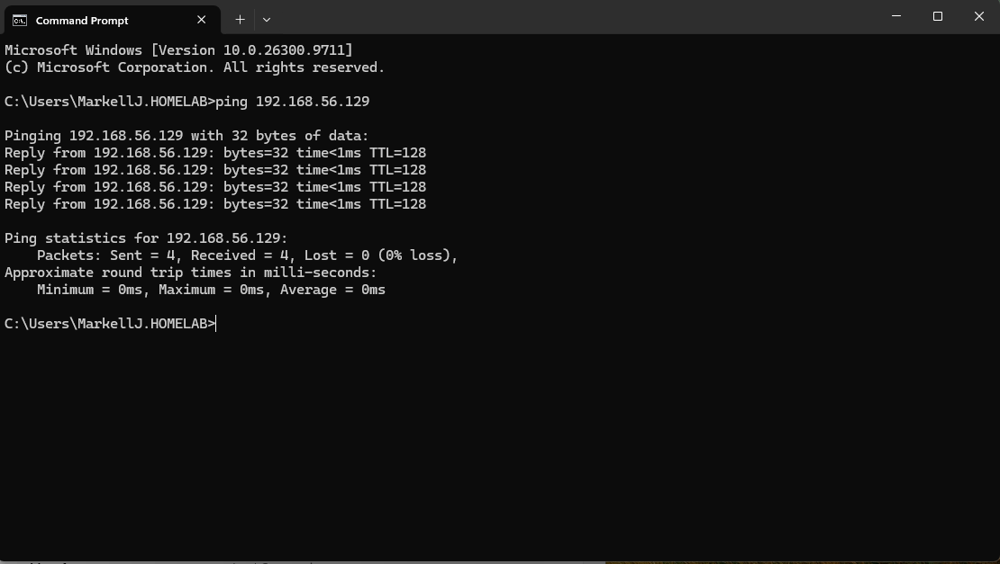
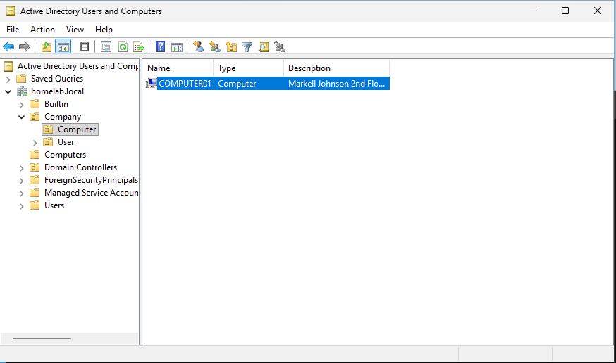

# Phase 7: Testing and Verification

**Project:** Active Directory Home Lab  
**Server:** Windows Server 2025  
**Client:** Windows 11  
**Domain:** HOMELAB.LOCAL  
**Domain Controller IP:** 192.168.56.129

## 1. Objective

The objective of this phase was to verify network communication between the Windows 11 client and the Windows Server 2025 Domain Controller and confirm that the client computer account exists in Active Directory.

## 2. Network Connectivity Test

A ping test was performed from the Windows 11 client to the Domain Controller to verify network connectivity.

**Command executed:**

```cmd
ping 192.168.56.129
```

### Results

| Test | Result |
|---|---|
| Destination IP | 192.168.56.129 |
| Packets sent | 4 |
| Packets received | 4 |
| Packets lost | 0 |
| Packet loss | 0% |
| Minimum response time | 0 ms |
| Maximum response time | 0 ms |
| Average response time | 0 ms |

**Outcome:** Successful.

All four ping requests received replies from the Domain Controller, confirming network communication between the Windows 11 client and server.

**Screenshot:** `Test-domain-user-authentication.PNG`



## 3. Active Directory Computer Account Verification

Active Directory Users and Computers was opened to verify the client computer account.

The `COMPUTER01` account was visible inside the `Company` organizational unit structure.

### Verified Domain Structure

```text
homelab.local
└── Company
    └── Computer
        └── COMPUTER01
```

### Verified Information

| Setting | Value |
|---|---|
| Active Directory domain | HOMELAB.LOCAL |
| Organizational structure | Company |
| Computer organizational unit | Computer |
| Client computer account | COMPUTER01 |

**Outcome:** Successful.

The `COMPUTER01` computer account was visible in Active Directory Users and Computers.

**Screenshot:** `Windows-Client-Moved-To-Active-Directory-Domain.PNG`



## 4. Troubleshooting Experience

### Active Directory Object Deletion Protection

**Problem:**

An Active Directory object could not be deleted because Windows reported insufficient privileges or protection against accidental deletion.

**Cause:**

The object had the Protect object from accidental deletion setting enabled.

**Resolution:**

1. Opened Active Directory Users and Computers.
2. Enabled Advanced Features from the View menu.
3. Opened the object's Properties.
4. Located the Object tab.
5. Disabled Protect object from accidental deletion.
6. Retried the deletion.

**Lesson Learned:**

Active Directory includes safeguards to prevent accidental deletion of important directory objects. Administrators should understand these protections before modifying or deleting objects.

## 5. Skills Demonstrated

- Testing network connectivity.
- Using Command Prompt for troubleshooting.
- Verifying Active Directory computer accounts.
- Understanding Active Directory organizational structures.
- Identifying accidental deletion protection.
- Troubleshooting Active Directory management issues.

## 6. Conclusion

The Windows 11 client successfully communicated with the Windows Server 2025 Domain Controller at `192.168.56.129`, with zero packet loss during the ping test.

Active Directory Users and Computers also confirmed that the `COMPUTER01` computer account exists within the `HOMELAB.LOCAL` domain.

This phase demonstrated practical experience with network connectivity testing, Active Directory management, and basic troubleshooting.
